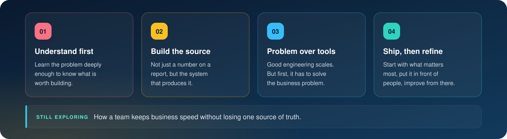

  

  
  
  
  

## Hi, I'm Vinh

I want to do data work that sits close to the business and its operations, and to own the engineering behind it myself.

Not just taking a request and pulling a number. Not just a dashboard, or a pipeline built to close a ticket. I want to understand a problem deeply enough to know what is worth building, and be technical enough to build it, then keep it growing as the problem changes.

Today I'm the only data person in the Supply Chain department at **PNJ Group**.

## What I believe

  

## The journey so far

  

## Work I'm proud of

- **Order traceability for a garment factory.** Planners no longer have to chase where an order is. They can see it, from confirmation to shipment.
- **A small data system for Supply Chain at PNJ.** Gives the team a shared view of its goals and KPIs, and a system it can shape as its questions change.
- **Multimodal sarcasm detection** (UIT DS Challenge 2024). Helping machines understand what people mean, not just what they say.

## Writing

Most of what I know came from getting things wrong first.

- [Đi tìm "bản ngã" nghề nghiệp](https://thanhvinh04.vercel.app/blog/di-tim-ban-nga-nghe-nghiep): what kind of data work I want to do, and why.
- [Một Data System nhỏ cho phòng Cung ứng](https://thanhvinh04.vercel.app/blog/mot-data-platform-nho-cho-phong-cung-ung): solve the business problem first, the tech comes second.
- [Chuyện mình chọn sai Grain](https://thanhvinh04.vercel.app/blog/chuyen-minh-chon-sai-grain): what a wrong early decision taught me.

**Tools I reach for:** SQL · Python · PostgreSQL · SQL Server · Power BI · Superset · FastAPI · PySpark

## Let's talk

If you care about data that changes how a business decides, I'd love to hear from you on [LinkedIn](https://www.linkedin.com/in/thanhvinh04/) or [Zalo](https://zalo.me/0862519793).
