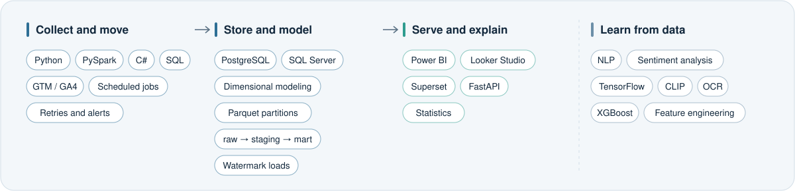

  

  
  
  
  

## Hi, I'm Vinh

I work between business and engineering. Most of my time goes into understanding an operational problem well enough to know what to build, then building it: KPIs, data models, pipelines, internal tools and reports.

Right now I'm the only data person in the Supply Chain department at **PNJ Group**, running a PostgreSQL warehouse (raw → staging → mart) with scheduled Python pipelines and an internal FastAPI app for QC and order tracking. Before that I came from the data science side, working on NLP and multimodal models, and I still use that background when a problem needs it.

Most of what I know came from getting things wrong first. I write about that on [my blog](https://thanhvinh04.vercel.app/blog).

## Where I've worked

  

## Selected projects

| Project | What it does | Built with |
|---|---|---|
| **Order traceability and WIP tracking** | Models the order lifecycle from confirmation to shipment for a garment factory's PPC team. Incremental loads use `LastUpdated` watermarks for ERP and a rolling window for Excel. Saved about 12h/week and cut manual progress inquiries by about 90%. | Power BI, Python, C#, SQL Server, dimensional modeling |
| **Multimodal sarcasm detection** (UIT DS Challenge 2024) | Detects sarcasm across text and images by combining OCR, CLIP embeddings and a CNN with self-attention. | TensorFlow, CLIP, OCR, Python |
| **Forecasting F1 race results** | Pulls race data from the FastF1 API with PySpark, engineers features such as pit-stop strategy and weather, then predicts results with XGBoost and Random Forest. | PySpark, FastF1, XGBoost |

## Toolkit

  

## Recent writing

- [Chuyện mình chọn sai Grain](https://thanhvinh04.vercel.app/blog/chuyen-minh-chon-sai-grain): my first full data project lifecycle, and the cost of picking the wrong grain.
- [Một Data System nhỏ cho phòng Cung ứng](https://thanhvinh04.vercel.app/blog/mot-data-platform-nho-cho-phong-cung-ung): three months as the only data person in a supply chain team.
- [Đi tìm "bản ngã" nghề nghiệp](https://thanhvinh04.vercel.app/blog/di-tim-ban-nga-nghe-nghiep): naming the kind of data work I want to do.

## Education and certifications

- **BSc in Data Science**, University of Economics Ho Chi Minh City (UEH), 2022–2025. GPA 3.95/4.0
- First Prize, Business Analytics Competition. Second Place, Economics Debate Competition
- [IBM Data Science Professional Certificate](https://www.coursera.org/account/accomplishments/specialization/FFRFH38V4AYP) (Coursera)

## Get in touch

Want to talk about data warehouses, pipelines or BI? Reach me on [LinkedIn](https://www.linkedin.com/in/thanhvinh04/) or [Zalo](https://zalo.me/0862519793).
